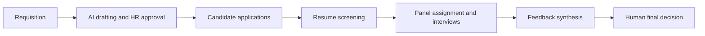

# AEGIS

**AI-Enabled Governance for Intelligent Selection**

*Fair hiring. No silence. Auditable AI.*

AEGIS is an AI-assisted hiring application built on the ServiceNow platform. AI agents handle the heavy processing (screening resumes, scheduling interviews, synthesising panel feedback), while people approve, review and make every final hiring decision. Every AI action is explained and recorded.

Built by **Team Crazy Coders**, PBR Visvodaya Institute of Technology and Science, for **ServiceNow University HackNow India 2026**.

---

## The hackathon

**ServiceNow University HackNow India 2026** is a hackathon held from 6 August to 6 November 2026, presented by **ServiceNow University** and **LTM**.

- **ServiceNow University** is ServiceNow's learning platform in India, set up to build AI skills among learners.
- **LTM** (formerly LTIMindtree) is a global IT services company and an Elite ServiceNow partner.
- Participating teams ideate, design and build a solution on ServiceNow, starting from a published problem statement.

AEGIS addresses the **Intelligent Recruitment Engine** problem statement: an AI-powered platform for candidate screening, interview scheduling, feedback analysis, hiring recommendations and AI-generated job descriptions, in which every AI decision is explainable, auditable and human-overridable.

---

## The problem

Hiring has become a black box. Applications arrive by the hundred, each resume gets seconds of attention, and rejected candidates are left with one unanswered question: *why?*

| Who | What goes wrong |
|---|---|
| Recruiters | Resume overload |
| Hiring managers | Unclear recommendations |
| Interview panels | Difficult comparisons between candidates |
| Candidates | No feedback |
| Compliance teams | Limited traceability |

Speed without transparency is not enough.

## The idea

**AI assists. Humans decide.**

| AI does | Humans keep |
|---|---|
| Job description drafting | Review and approval |
| Bias detection in job descriptions | Recommendation review |
| Resume screening | The final hiring decision |
| Panel assignment and interview questions | Justified overrides |
| Feedback synthesis | |

Every decision leaves a receipt: every AI score has reasons, every AI recommendation lists strengths and concerns, and every human override carries a written justification.

## How it works

1. **Requisition.** A hiring manager raises a job requisition with headcount, required skills, interview window and panel.
2. **AI drafting and HR approval.** AI drafts the job description and checks it for biased wording. HR approves it.
3. **Candidate applications.** Candidates apply, and the resume text is stored on the application.
4. **Resume screening.** The Resume Intelligence Agent scores every resume blind, with reasons.
5. **Panel assignment and interviews.** Recruiters shortlist. The Panel Assignment Agent books conflict-free interviews with one panelist each and prepares tailored questions.
6. **Feedback synthesis.** Panelists submit feedback. The Feedback Synthesis Agent ranks candidates against the number of openings and recommends Select, Hold or Reject.
7. **Final decision.** The hiring manager records the human decision. Overriding the AI requires a written reason.

**No candidate is silently rejected.** A rejection is confirmed by a person, and the AI never rejects on its own.

## The AI agents

### Resume Intelligence Agent
Scores each application's resume against the job requisition and description.

- **Blind screening.** Name, gender, photo, date of birth, marital status, nationality, religion, address, institution and graduation year are ignored. Candidates are referred to by application number.
- **Five factors**, each scored 0 to 100: skills, experience, education, projects, certifications.
- **Weighted fit score** (skills 35, experience 25, education 15, projects 15, certifications 10). A factor with no evidence in the resume is left empty rather than scored zero, and its weight is shared across the scored factors.
- **Explained results.** Each result carries matched skills, skills not evidenced, transferable skills and a per-factor explanation.
- Unreadable resumes are recorded as errors with a reason, never silently skipped.

### Panel Assignment Agent
Turns the shortlist into a booked interview schedule.

- Assigns **one panelist per interview** from the requisition's panel, spreading the load evenly. Panelists can interview in parallel.
- Reads the free-text interview schedule (dates, daily timings, lunch and breaks) and builds back-to-back slots around the breaks.
- **Checks panelist conflicts across all requisitions before every booking.** A candidate with no free slot is reported as Unassigned with a reason, never forced in.
- Candidates are queued oldest application first, never by score.
- Writes **5, 7 or 10 questions** depending on interview length, each with an approximate expected answer and a scoring rubric, grounded in the candidate's real resume and the role.
- Skips candidates who already have an active interview, so re-runs create no duplicates.

### Feedback Synthesis Agent
Turns panel feedback into a ranked, evidence-based recommendation.

- Uses only submitted interview feedback: technical, communication, culture and overall scores, strengths, concerns and the panelist's recommendation.
- **Headcount is a hard cap on Select.** If fewer candidates qualify than there are seats, the extra seats stay empty. The system never lowers the bar to fill a number.
- Strong candidates beyond the cap are Hold. Weak candidates or those with serious concerns are Reject, whatever their rank.
- **Every justification lists strengths and concerns**, even for Select, together with the comparison to other candidates and the effect of headcount.
- Never overwrites a decision a human has already made. Interviews with no submitted feedback are reported, never judged on missing data.

All three agents end each run with an audit log entry and a count report that adds up to the total.

## Governance by design

- **AI recommends, humans decide.** Agents never change hiring stages, never touch the human decision fields and never reject.
- **Blind scoring** with no protected traits used or inferred.
- **Explainability.** Scores, recommendations and overrides all carry their reasons.
- **Audit trail.** Every agent run writes an AI Decision Log entry. Database rules block edits and deletes on the log.
- **Least-privilege access.** Roles and ACLs separate recruiters, hiring managers, panelists, auditors and administrators. Panelists see only their own interviews and feedback.
- **Safe re-runs.** Existing interviews, decisions and completed screenings are never duplicated.
- **Failure handling.** Problems appear as an error, an Unassigned candidate or a Feedback Missing flag with a reason, never as a forced result.
- **Untrusted input.** Resume, requisition and job description text is treated as data, never as instructions.

## Roles

| Role | What they do in AEGIS |
|---|---|
| Recruiter (HR) | Manages requisitions, reviews screening results, shortlists and confirms interviews |
| Hiring manager | Raises and approves requisitions, reviews AI recommendations, records the final decision |
| Interview panelist | Sees assigned interviews and questions, submits structured feedback |
| Compliance auditor | Read-only access to decisions, AI explanations and audit records |
| Candidate | Applies and tracks their application |
| Application admin | Configures the application, security and AI agents |

## Notifications

When an agent finishes, the right people are emailed automatically: recruiters when screening completes, recruiters and hiring managers when interviews are scheduled or recommendations are ready, and the assigned panelist when an interview is booked. A separate "needs attention" email goes out when a run finishes with errors. Emails use application numbers only, never candidate names.

## Data model

AEGIS is a scoped ServiceNow application with these core tables:

| Table | What it holds |
|---|---|
| Job Requisition | The opening: role, headcount, skills, interview window, panel |
| Job Description | The AI-drafted, bias-checked and approved description |
| Candidate | The person applying |
| Application | A candidate applying to a requisition, with the resume and screening status |
| Screening Result | The blind score, factor breakdown and explanation |
| Interview | The booked slot, panelist and prepared questions |
| Interview Feedback | A panelist's scores, strengths, concerns and recommendation |
| Hiring Decision | The AI recommendation and the human decision, with any override reason |
| AI Decision Log | The audit trail of every agent run |

## Built with

- **ServiceNow** (Australia release), as a scoped application
- **Now Assist AI Agent Studio** for the agents and their tools
- **Flow Designer** to start each agent when a requisition reaches its stage
- **ACLs, roles and business rules** for access control and audit protection
- **Email notifications** for completion and attention alerts

## Roadmap

| When | What |
|---|---|
| **Next** | Score-based routing (high scores move on, low scores go to human review), candidate emails for interviews and rejections, Outlook and Teams invitations, candidate chat assistant, fairness dashboard on live data |
| **Then** | Auto-marked coding and aptitude tests, recruiter copilot ("who are my strongest candidates?"), re-matching past applicants |
| **Later** | Job-board posting, HRMS and onboarding hand-over, multi-language interface |
| **Vision** | A fully configurable hiring pipeline where HR defines the rounds, evaluators, rubrics and pass marks, and AEGIS executes them |

## Team

**Team Crazy Coders**, PBR Visvodaya Institute of Technology and Science

| Name | Role |
|---|---|
| Kaustubh Thallam | Team Lead, Solution Architect |
| Rakesh Sankar Pydi | AI and Automation Engineer |
| Deepthi Parisigani | Experience Developer |
| Chaitanya Saradhi Gadamsetty | Application Developer |
| Mahesh Juvvaldinne | Analytics and Quality Lead |

---

*Let AI do the processing. Let humans own the decisions. Let evidence speak for both.*
